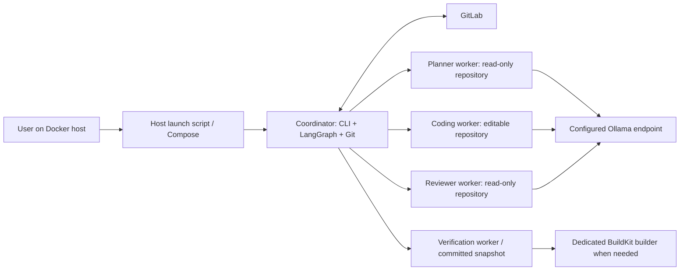
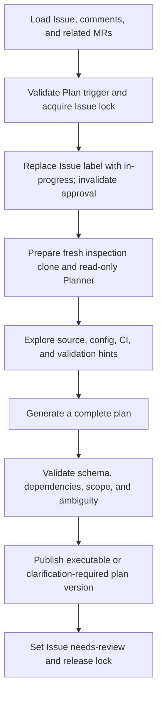
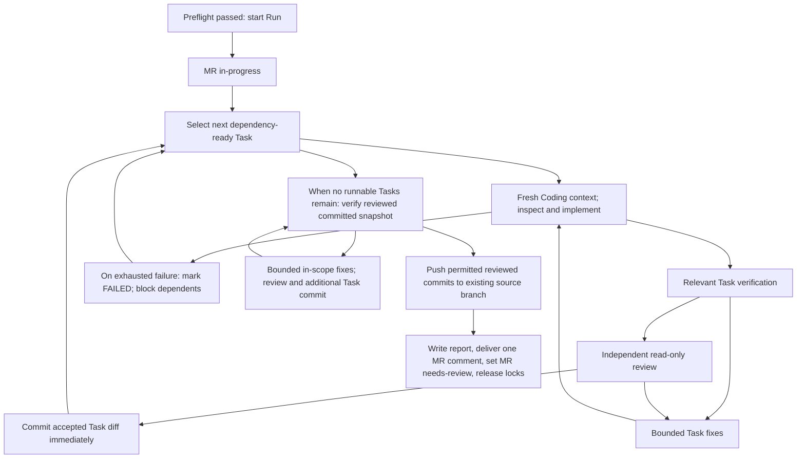

> **Superseded historical design:** Use the [current Phase 0 manual workflow contract](MANUAL_WORKFLOW_CONTRACT.md) and GitHub Issue #6 with its linked slices. Conflicting requirements below are inactive, including label-selected modes, plan versions, mandatory Docker, per-Task commits, partial publication, and the old runtime limit.

# Coding Agent Phase 0 implementation plan

Status: accepted design; implementation has not started through this document.

Scope: a Docker-based prototype for the agreed happy path. The final interview decisions take precedence over conflicting details in the original overview and templates.

Related material:

- [Original Phase 0 overview](CODING_AGENT_PHASE0_OVERVIEW.md)
- [Report templates](report_template/)
- [Domain glossary](../GLOSSARY.md)
- [ADR 0001: fresh workspaces and GitLab records](adr/0001-fresh-workspaces-and-gitlab-records.md)
- [ADR 0002: Docker role isolation](adr/0002-docker-role-isolation.md)
- [ADR 0003: semantic task scope and publication](adr/0003-semantic-task-scope-and-publication.md)

## 1. Intended outcome

```text
New Issue -> Plan -> User approves plan -> User creates source branch/MR
          -> Implement -> Human review, approval, and merge
```

Keep the main command:

```bash
python main.py --project "group/project" --issue 123
```

GitLab labels select the mode. The agent never creates the product source branch or MR, changes its target branch, approves a merge, or merges it. Docker launchers wrap this same Python command rather than introducing a second workflow interface.

### 1.1 Agreed prototype contract

| Area | Implementation requirement |
|---|---|
| Approval | Check label values only. No approver identity, role, allowlist, or historical authorization checks. |
| Approval transition | On the Issue, the user removes `agent::needs-review` and applies `agent::approved`. Both labels together are invalid. |
| Plan storage | Publish complete Markdown and a structured JSON payload in one Issue comment per version. GitLab is the work-agreement record. |
| Plan regeneration | Read the Issue and all comments again, generate a complete new version, and invalidate approval. No incremental feedback ledger or automatic cross-version Task-ID preservation. |
| Ambiguity | Publish unresolved questions and a non-executable plan. An approval label cannot make that plan executable. |
| Execution | One Coding Agent processes tasks sequentially in dependency order. An independent read-only Reviewer checks each Task before commit. |
| Freshness | Every Execute Run has new context, a new clone, new workspace volume, and fresh exploration. No restored conversation, local checkpoint, or previous workspace. |
| Scope | Follow Task purpose and acceptance criteria. Do not require `allowed_paths`. Relevant new files are permitted. |
| Product files | Relevant code, runtime assets, and unit tests are permitted; configuration, dependencies, SQL/schema/migration files require explicit Task coverage. |
| Excluded files | Do not commit or push documentation changes, agent memory, summaries, logs, reports, caches, or other unrelated files. |
| Verification | Agent may discover or derive commands for legacy projects and adapt them during Execute without reapproval when scope stays unchanged. |
| Dependencies | Download/install project dependencies in the run environment; dependency-file changes still require approved scope. |
| Build | Mandatory for relevant modules. Dockerfile builds are allowed when they validate the changed product code. |
| Unit tests | Use existing relevant tests/frameworks. Missing tests are `SKIPPED`; do not introduce target-project test infrastructure. |
| Runtime | Linux containers on one Docker host, with coordinator and role workers. Native Windows execution is deferred. |
| Coordination | Shared control storage provides Issue/branch locks. It does not store resumable run state. |
| Reporting | One append-only final MR report per started Run, with best-effort delivery while the process and GitLab remain available. |
| RAG | Phase 1 exploration aid; it is not implemented in this prototype. |

### 1.2 Explicitly deferred or excluded

- Parallel coders, file ownership scheduling between concurrent coders, and distributed execution.
- Detecting plan staleness from source/target movement since approval, adopting human work into Task status, and reconciling earlier Runs.
- Persistent workflow checkpoints, SQLite run state, restart resume, automatic workspace recovery, and automatic destructive cleanup.
- Incremental plan editing, old/new/resolved-feedback classification, and stable Task matching between plan versions.
- Multi-repository changes, deployment projects, deployment, real-database access, and running migrations against real environments.
- Target-repository integration/E2E tests and new test-framework infrastructure.
- A user-facing web interface/API and automatic MR creation, approval, or merge.

Basic Git protection stays in scope: clean initial checkout, correct existing source branch, explicit staging, preserved user commits, normal non-force push, and truthful reporting. Deferring drift analysis does not authorize pull, rebase, merge, reset, squash, or overwriting remote work.

## 2. Current code and required changes

These are repository observations, not capabilities already supplied by the new design.

| Current file | Current behavior | Required change |
|---|---|---|
| `main.py` | Always invokes one graph; exposes branch/MR creation options; writes a summary only after graph return. | Route by labels, add Plan-only `--branch`, provide mode-specific output, and save available diagnostics from finalization. |
| `src/workflow.py` | Fetches Issue, clones target/default, creates an agent branch, invokes one coder, checks, and publishes. | Separate Plan and Execute graphs; remove branch/MR creation; add plan gates, sequential Task execution, review, and finalization. |
| `src/workflow.py:274` | The temporary `checks_not_configured` route publishes and can print success. | Remove this route. Publication outcome and verification outcome must be separate. Missing Build can never produce `SUCCESS`. |
| `src/gitlab_client.py` | Project/Issue reads, branch-filtered MR lookup, and MR creation; no pagination loop, notes, or labels. | Add paginated context/history reads, related-MR validation, append-only notes, and label transitions preserving unrelated labels. |
| `src/git_ops.py` | Depth-one clone, new source branch, global staging except `.agent-summary.md`, combined commit/push. | Clone the existing source branch; split review-bound staging/commit from push; inspect task and full-run diffs. |
| `src/openhands_runner.py` | One coding prompt with terminal/editor/tracker tools; removes two environment variables temporarily; reads a summary from inside the checkout. | Role-specific fresh contexts, remote worker execution, structured results, real read-only roles, and external artifacts. |
| `src/checks.py` | Root-manifest detection and host subprocesses; requires both Build and Test commands; uses several noncanonical statuses. | Module-aware discovery/derivation, worker execution, dynamic commands, optional absent tests, and canonical outcomes. |
| `src/config.py` | Defaults to 35 iterations; lacks the total execution budget. | Set 60 iterations, separate invocation deadline from request timeout, add total deadline and runtime endpoint settings. |
| `requirements.txt` | SDK/tools have no major upper bound; no tested remote-worker package set is recorded. | Select and lock a compatible SDK/tools/workspace/server set after a runtime compatibility probe. |
| `src/prompt/base_prompt.md` | Prompts the agent to create `.agent-summary.md` inside the checkout. | Replace with role prompts and structured output stored outside the product repository. |

There is currently no Docker packaging, dependency lock, declared tested Python version, or project test suite. Do not describe those as already working.

## 3. CLI and label contract

### 3.1 CLI compatibility

- Keep required `--project` and `--issue` and existing GitLab URL/output-directory configuration.
- Add `--branch` only for choosing the Plan inspection baseline; reject it for Execute.
- Retain setup/build/test options as optional hints or explicit user suggestions, not required legacy-project configuration and not permission to deploy or run integration tests.
- Retain the repair-limit override if needed, with the counter semantics in section 10.
- Remove the obsolete `--target-branch`, `--mr-title`, `--mr-description`, and `--draft-mr` creation controls. Return an actionable argparse error if used.
- Do not introduce `--mode`, `--execute`, `--publish`, or `--max-runtime`.

### 3.2 Label validation and routing

Only inspect recognized agent labels when validating agent states; preserve unrelated Project labels.

| Object | Valid single agent states |
|---|---|
| Issue | `agent::plan`, `agent::in-progress`, `agent::needs-review`, or `agent::approved` |
| MR | `agent::implement`, `agent::in-progress`, or `agent::needs-review` |

More than one recognized state on an object is invalid, including `needs-review` plus `approved` on the Issue. An in-progress label is not an automatic request to resume.

| Trigger | Action |
|---|---|
| Issue has `agent::plan`, no conflicting agent state | Plan. |
| Issue has `agent::approved`, and a related open MR has `agent::implement` | Execute preflight. |
| Triggers/states conflict | Stop with instructions; do not guess precedence. |
| No trigger, missing approval/MR preparation, or existing in-progress state | Stop with instructions; do not edit code. |

Transitions:

```text
Issue: agent::plan -> agent::in-progress -> agent::needs-review
User:  remove needs-review -> add agent::approved
MR:    agent::implement -> agent::in-progress -> agent::needs-review
```

Execute does not change the Issue's approved label into an execution status. Issue and MR status transitions are independent. A new Plan invalidates old approval and ends with Issue `needs-review`.

Explicitly remove the prior recognized state when adding the next state; do not rely on tier-specific automatic scoped-label replacement. Use add/remove label operations so other labels remain intact. Re-read state after acquiring the relevant lock before beginning work.

### 3.3 Branch and MR selection

Plan selection follows the original overview:

1. Explicit `--branch` wins.
2. No related MR: Project default branch.
3. One related MR: its target branch.
4. Several related MRs with exactly one open MR: that open MR's target branch.
5. Multiple open MRs: require `--branch` for Plan.
6. Other ambiguous historical-MR cases: request an explicit branch rather than selecting an arbitrary historical target.

The coordinator creates the inspection clone before exposing it read-only. Plan may materialize an existing ref, preferably detached at its inspected SHA; it must not invent a source branch or modify the inspected repository after preparation.

Execute requires exactly one related open MR. Both its source and target Project IDs must equal the Issue Project ID, its existing source branch must exist, and it must carry `agent::implement`. Zero or several open related MRs are preflight failures. Keep the MR title, description, source branch, and target branch user-owned.

For the prototype walkthrough, the user links the MR explicitly with `Closes #123` in its description. Discovery should use GitLab's Issue/MR relationship endpoints, not branch-name guesses or Issue-title matching.

## 4. Runtime and workspace design



### 4.1 Containers and responsibilities

| Runtime | Repository access | Credentials and tools |
|---|---|---|
| Coordinator | Read/write clone and Git metadata | GitLab token, Git commands, API client, workflow state, worker clients. No product coding conversation. |
| Planner | Read-only prepared snapshot | Read/search tools and LLM access. No editor or writable coding-worker endpoint. |
| Coder | Read/write current run's product files | Coding tools and LLM access. No GitLab token; Git metadata must be hidden or read-only. |
| Reviewer | Read-only current files and supplied Task diff | Separate LLM context and read tools. No editor or writable worker access. |
| Verification | Current Task checkout or isolated committed snapshot, depending on stage | Project toolchains and dependency access; no GitLab token. Build output stays in this run. |
| Builder | Build context supplied by verification | Dedicated image-build capability, without a host Docker socket in coding tools. |

Use Compose to start separate Agent Servers and connect to their supported remote workspace interface. Do not make each SDK invocation launch another Docker container through a mounted host socket. Run setup must validate worker access modes and writable directories, not rely solely on prompt instructions.

Choose a supported Python runtime and pin the tested OpenHands package set during M1; current upstream documentation specifies Python 3.12+. Verify actual tool import names and remote conversation behavior against the selected release before changing the runner. Keep one configured Ollama model for all roles initially; normalize the provider/model string once instead of accumulating `openai/ollama/...` prefixes.

Target toolchains follow the repository: provision suitable JDK/Node/etc. worker images or use a repository Dockerfile. Missing required toolchains produce `BLOCKED` rather than host mutation or fabricated results.

### 4.2 Per-operation and shared storage

| Storage | Lifetime | Content |
|---|---|---|
| New operation/workspace volume | Unique to each Plan attempt or Execute attempt | Fresh clone and within-run working code. |
| New artifact directory/volume | Unique to the operation | Logs, agent results, check output, report JSON, optional image exports. Outside the checkout. |
| New builder state | Unique to the run when Dockerfile validation is used | Temporary image-build state. No previous-run build cache assumed. |
| Shared control volume | Shared by invocations on this Docker host | Active lock files/ownership metadata only; no checkpoint, task ledger, or persisted LLM context. |

Host launch scripts for PowerShell and POSIX shells generate a unique operation identifier, start a distinct Compose project, forward the existing CLI arguments, and preserve volumes on failure. They must not run `down --volumes` or delete failed clones automatically. Successful-run cleanup is an explicit operator action until a retention policy is added.

The control lock protects `(GitLab instance, Project ID, Issue IID)` and, for Execute, `(GitLab instance, Project ID, source branch)`. Acquire locks in one stable order; reject concurrent ownership immediately. An advisory lock released by process exit is sufficient; stale labels and orphaned diagnostic directories are not resume instructions. Lock Plan publication on the same Issue as well to prevent two local invocations allocating the same plan version.

Dependencies, agent state, and workspaces are not restored from prior runs. Retaining diagnostics does not authorize using them as a new run's workspace.

### 4.3 Dockerfile validation

Support a dedicated builder service, preferably rootless BuildKit with a verification client. The host launcher owns its lifecycle. Check the required host/kernel/security configuration during runtime setup; do not silently grant privileged access when the configured builder cannot start.

Supply only the run's relevant build context. Build the relevant target without pushing images to a registry or deploying containers. A successful image build counts as the product Build check only when its selected stages actually validate the changed code; copying an old binary, skipping a compile stage, or defining a runtime `CMD` is insufficient evidence of compilation. Run relevant unit tests separately if the selected build graph does not execute them. Keep logs and optional image exports outside the Git checkout.

### 4.4 Workspace and Git protection

- Clone only the Issue Project. Execute checks out the existing MR source branch, preserving its current commits.
- Record the initial source SHA and inspected ref as execution evidence, not as a plan-drift gate.
- Stop on dirty initial status, unexpected staged changes, wrong origin/Project, missing source ref, or an invalid MR. Do not stash or reset.
- Keep Git credentials out of remote URLs and persistent clone configuration.
- Coordinator-only commit/push; worker tools cannot create branches, mutate `.git`, commit, push, or contact publication endpoints with the coordinator's credentials.
- Never force push. A remote update that causes normal push rejection is reported; no automatic pull/rebase/merge or overwrite follows.
- Keep Issue/repository instructions subordinate to runtime scope. Do not expose production secrets, real DB credentials, or deployment capabilities to project commands.

## 5. Data contracts

Use typed Python data structures with explicit runtime validation. Do not treat unchecked LLM text as executable workflow state. Keep transport clients injectable so the graphs can be tested without live GitLab or LLM calls.

### 5.1 Execution Plan payload

Illustrative schema shape; exact Python types are established in M1/M3:

```json
{
  "schema_version": 1,
  "kind": "execution_plan",
  "publication_uid": "unique-operation-id",
  "project_id": 42,
  "project_path": "group/project",
  "issue_iid": 123,
  "version": 1,
  "plan_id": "PLAN-v1",
  "generated_at": "2026-11-09T09:00:00Z",
  "baseline": {"branch": "main", "sha": "inspected-sha"},
  "executable": true,
  "unresolved_questions": [],
  "requirement_understanding": "Expected product behavior",
  "impact": [{"module": "api/search", "required": true, "reason": "Search contract"}],
  "tasks": [{
    "id": "TASK-001",
    "title": "Support SKU search",
    "scope": "Search by SKU without changing existing name matching",
    "modules": ["api/search", "web/search"],
    "dependencies": [],
    "acceptance": ["SKU search returns the matching product"],
    "verification": ["Existing search unit tests and relevant module builds"],
    "configuration_changes": [],
    "database_file_changes": [],
    "status": "PENDING"
  }],
  "validation_hints": [{
    "module": "api",
    "kind": "BUILD",
    "command": "./mvnw -B -DskipTests package",
    "cwd": "api",
    "origin": "DETECTED",
    "confirmation": "UNVERIFIED"
  }]
}
```

Validate matching Project/Issue, supported schema, positive version, nonempty requirement/scope/acceptance, unique Task IDs, known dependencies, acyclic dependency graph, and valid module working directories. Reject disallowed work even when it appears in generated JSON. `executable=true` requires no unresolved questions and sufficient requirement detail; an unknown Build command is recorded as a verification limitation rather than invented evidence.

`modules` describes semantic scope; it is not `allowed_paths`. File creation is allowed when related to the Task. Task IDs are unique within a plan version and need not retain their meaning in the next version.

Render the human plan using template 02 and append a fenced JSON payload in a clearly marked, collapsible metadata section. Markdown and JSON must come from the same validated object. Publish one complete comment for each version, never edit the old comment.

Keep version allocation and publication inside the Issue lock. If a Plan POST response is lost, search notes for the same `publication_uid` before posting again; an unresolvable delivery result is an error rather than permission to create duplicate versions.

Recognize plan records by a versioned marker, schema, and matching Project/Issue fields. Select the highest published version; a malformed or non-executable latest record blocks Execute rather than falling back to an older plan. This prototype does not verify approver identity, approval timestamps, signed content, or historical plan/source correspondence. Under the agreed manual happy path, the current approved label approves the latest published plan, which must itself be executable.

On regeneration, version is the next published plan number under the Issue lock. Read all Issue comments, including natural-language requirements; create the full replacement plan without a feedback-status ledger or automated partial-plan reuse. Every regeneration requires new approval, even if much of the content remains the same.

### 5.2 Runtime records

| Record | Essential fields |
|---|---|
| `IssueContext` | Project and Issue identifiers, Issue description/labels, all paginated notes, related MRs. |
| `TaskResult` | Plan/Task IDs, status, changes and review evidence, retry counts, commit SHAs/messages, verification references, failure/block reason. |
| `ReviewResult` | Accepted/revision-required outcome, acceptance checks, scope findings, requested changes, reviewed diff fingerprint. |
| `CheckResult` | Module, type, command/argv, working directory, discovered/proposed origin, status, exit code, start/end/duration, log reference, excerpt, failure category. |
| `RunResult` | Unique run UID, display Run ID, plan/Issue/MR IDs, source branch/initial SHA, start/end, Task results, checks, push result, overall result, next action. |
| `DeliveryResult` | Local report path, MR note ID if known, report delivery status, label-update status, API error evidence. |

Agent summaries and structured Task results go directly to artifact storage. Do not use a repository `.agent-summary.md` as the normal output channel.

### 5.3 Identity conventions

- Plan: `PLAN-v1`, `PLAN-v2`, ... per Issue.
- Task: `TASK-001`, ... within one plan version.
- Display run: `RUN-001`, ... allocated under the Issue lock from prior published execution-report records for that Issue.
- Internal `run_uid`: a random unique identifier for artifact paths and report deduplication, created before publication and independent of display numbering.
- Commit: `agent(#123-P2-R001-T001): support SKU search`, with a run-UID trailer for unambiguous diagnostics.

Reading earlier report numbers does not resume their Tasks. A crash before final report publication can leave an unrecorded display number; the unique UID distinguishes the attempt. Strict crash-proof sequential number reservation is outside the prototype and must not be claimed.

## 6. Proposed module responsibilities

Retain useful existing modules and move responsibilities behind small interfaces rather than rewriting transport code unnecessarily.

| File | Intended interface/responsibility |
|---|---|
| `main.py` | Parse/validate arguments, load settings safely, invoke the router, print mode-specific results, choose exit code. |
| `src/config.py` | Validated settings and environment defaults; worker/builder endpoints; execution limits. Invalid env values become actionable CLI errors. |
| `src/models.py` (new) | Plan/Task/Run/check records, enums, schema validation, retry counters, and budget values. |
| `src/gitlab_client.py` | Paginated Issue context and related-MR reads; plan/report note publication; agent-label transitions; no branch/MR creation in the workflow. |
| `src/workspace.py` (new) | Per-operation workspace references, worker access configuration, fresh checkout preparation, and shared lock acquisition/release. |
| `src/git_ops.py` | Clone existing refs, inspect clean/current state, obtain complete diffs, commit reviewed Task changes, inspect run commit range, push the existing source branch. |
| `src/openhands_runner.py` | Fresh role-specific SDK contexts, remote workers, structured planner/coder/reviewer results, invocation cancellation/deadlines. |
| `src/planning.py` (new) | Generate/validate full plans, determine versions, encode/decode note payloads, and render template 02. |
| `src/execution.py` (new) | Dependency-ordered sequential Task state machine, review/fix cycles, commit coordination, final verification fixes. |
| `src/checks.py` | Discover/derive/classify commands, execute in verification workers, map results, and collect module-aware evidence. |
| `src/reports.py` (new) | Local Run JSON, success/partial/failure Markdown, deduplicated final-note delivery, and final label outcome. |
| `src/workflow.py` | Label router plus `build_plan_graph` and `build_execute_graph`; orchestration rather than embedded Git/API/LLM implementation. |
| `src/prompt/` | Planner, coder, reviewer, and verification-discovery instructions, each scoped to the granted tools. |
| `Dockerfile`, `compose.yaml`, `docker/`, `scripts/` (new) | Reproducible runtime images, role mounts, optional builder, and host launch helpers. |

Illustrative call shapes:

```python
build_plan(issue_context, repository_inspection) -> ExecutionPlan
validate_plan(plan, project_id, issue_iid) -> None
read_latest_plan(issue_notes, project_id, issue_iid) -> ExecutionPlan
implement_task(task_context, workspace, budget) -> CodingResult
review_task(task_context, task_diff, workspace, budget) -> ReviewResult
verify(scope, workspace_snapshot, command_hints, budget) -> VerificationResult
commit_reviewed_task(repo, reviewed_change, identity) -> CommitRecord
push_existing_branch(repo, branch, budget) -> PushResult
finalize_run(run_result, delivery_context) -> DeliveryResult
```

These are implementation targets, not current functions. Use real transport adapters where execution varies, and simple injected callables/clients for tests; avoid introducing a general agent framework or hypothetical provider hierarchy.

## 7. Plan graph



Plan must not install dependencies, run project setup/build/tests, edit repository content, commit, push, or create a product branch/MR. Build/test commands in the plan are hints with discovered/proposed origin, not execution evidence. Logs and SDK state use external artifact paths.

If requirements conflict, include explicit unresolved questions and `executable=false` in a complete plan record. A user must clarify the Issue/comments and request a new Plan; adding `approved` to the blocked version does not bypass this gate. Infrastructure errors must not publish malformed JSON as a usable plan.

## 8. Execute graph and Task behavior

### 8.1 Preflight and Run boundary

Before a Run starts:

1. Load Issue context and validate labels.
2. Load the latest plan; validate schema, Project/Issue match, executable state, and approval label.
3. Resolve exactly one open, same-Project MR and its existing source branch; require `agent::implement`.
4. Acquire Issue and branch locks; revalidate current labels/MR and select the still-current latest plan.
5. Prepare a fresh source-branch clone; inspect status, staged/unstaged diff, origin, branch identity, and available publication access.
6. Initialize artifact paths, run identity, independent counters, and deadline.

Any rejection here is a CLI/local diagnostic, not an Execute Run or MR execution report. Do not edit product files. Permission probing must be read-only; do not test access by pushing a temporary branch.

After preflight succeeds, record `started_at`, begin the 7,200-second Run budget, and transition the MR to `agent::in-progress`. Failures from this point go through Run finalization.

### 8.2 Sequential graph



Each decision edge needs an explicit outcome in the graph; the diagram summarizes the loop rather than directing every successful check through a fix. Graph state and counters must bound cycles even when LLM output is malformed. Size LangGraph's recursion limit for Task count and bounded loops, not the current single global repair counter.

### 8.3 Task states and failure handling

Runtime states are `PENDING`, `IN_PROGRESS`, `REVIEW`, `REVISION`, `COMPLETED`, `FAILED`, and `BLOCKED`. Terminal report statuses are `COMPLETED`, `FAILED`, `BLOCKED`, and `PENDING`. Partial uncommitted implementation is evidence attached to `FAILED`, not a competing final `PARTIAL` status.

- Select Tasks in topological order; keep unrelated Tasks runnable when one fails.
- A Task completes after acceptance/scope review and its required Task checks, then receives its own commit immediately. A genuinely complete no-change Task can have no new commit if the Reviewer records evidence; this is not cross-run Task-state adoption.
- A failed Task blocks descendants. Preserve its uncommitted changes and logs outside the path used to continue product editing: archive its patch, new/untracked files, and relevant workspace evidence first.
- Continue independent Tasks from a fresh working copy of the same run's current committed source history when failed changes would contaminate them. Retain the failed working copy; do not reset or clean it. This is within-run isolation, not restart recovery.
- There is still one active Coding Agent and one active product editing workspace at a time. Every Execute Run starts with fresh volumes; an additional within-run working copy does not reuse a previous Run.
- Final Build/Unit Tests run on a separate snapshot containing exactly the reviewed commits proposed for push. Failed/uncommitted edits must not influence the result claimed for those commits.
- A final verification regression returns to the responsible in-scope Task. Every resulting fix is reviewed and committed separately with the same Task identity; do not amend/squash earlier commits.
- If a fix requires new requirement scope, stop that work and request a complete new Plan and approval.

### 8.4 Scope and commit gates

The coordinator must collect full staged/unstaged/untracked changes, including binary changes, renames, deletions, and new files. The Reviewer checks the actual diff against Task purpose, acceptance criteria, and explicit configuration/database-file scope.

Before each commit:

1. Require accepted review for the exact diff fingerprint being committed.
2. Exclude documentation changes and agent memory/summaries/logs; detect accidental artifacts, unrelated files, and prohibited changes.
3. Stage only this reviewed Task's changes using explicit paths and safe argument handling; never use repository-wide `git add -A`.
4. Reinspect the index and ensure its diff matches the accepted review. Reject a changed diff rather than using stale review approval.
5. Create a Task commit and record SHA/message; keep original user commits intact.

The execution-generated staging inventory is not a preapproved file allowlist. It records what was actually reviewed. A new source/test file can be valid; a new agent-memory file cannot.

Before push, inspect all commits and the full change range introduced by the Run relative to its initial source SHA, not only the final net diff. Every introduced commit must have accepted review evidence; no temporary artifact commit may be included even if a later commit deletes it. Existing branch history is preserved, not retrospectively rewritten or removed.

## 9. Verification behavior

### 9.1 Discover and derive commands

Inspect relevant modules and demonstrably affected dependents, not just repository-root manifests. Sources include `AGENTS.md` when present, package scripts/lockfiles, Maven/Gradle configuration, existing scripts/Makefiles, CI, Dockerfiles, and source layout. Legacy repositories do not require `AGENTS.md` or configured Build/Test strings.

The agent can propose commands, select a different valid command during Execute, and install dependencies. Record every actual command, working directory, toolchain, origin (`DETECTED`/`PROPOSED`), and output. Do not freeze Execute to Plan hints or require reapproval merely for command selection within the approved scope.

Before execution, inspect the command and referenced scripts/targets for deployment, real DB access, migration execution, integration/E2E tests, and out-of-Project effects. A generic `test`, Maven goal, or CI job is not automatically a unit-only command. If allowed checks cannot be separated confidently, report `BLOCKED`/`UNVERIFIED` rather than executing excluded work.

Run commands in verification environments without coordinator credentials. Default to structured argv with an explicit working directory. When a repository script needs shell syntax, make shell execution explicit and inspect the whole script/compound command; do not silently interpret arbitrary strings differently across platforms.

Dependency installation uses the repository's declared sources/lockfiles. Configuration or manifest edits require explicit Task coverage. Prefer a dependency setup step once per relevant run/module, repeating only when a changed dependency or an actual setup failure justifies it.

### 9.2 Status classification

| Check situation | Status |
|---|---|
| Allowed command ran and succeeded | `PASS` |
| Allowed command ran and failed because of product code | `FAIL` |
| No existing relevant unit-test suite/framework, or irrelevant module | `SKIPPED` with reason |
| Command exists but toolchain, dependency access, timeout, or environment prevents execution | `BLOCKED` |
| No credible Build method or insufficient evidence of what was validated | `UNVERIFIED` |

Build is mandatory for in-scope and demonstrably affected modules. Relevant configured unit tests are mandatory; do not invent new test infrastructure when absent. `SKIPPED` is never a Build success substitute. A known old failure may be recorded as unrelated and must not trigger scope expansion, but a failing mandatory check still prevents overall `SUCCESS`.

An absent configured test command alone is not grounds to skip an existing test suite: derive a suitable unit-test command for the legacy project, or report the unresolved execution as `UNVERIFIED`/`BLOCKED`.

Where practical, perform an Execute-only baseline check before editing to distinguish existing failures from regressions; it uses the same Run budget. Do not add a requirement for a historical baseline analysis or run any such command in Plan Mode.

### 9.3 Overall result

| Result | Rule |
|---|---|
| `SUCCESS` | All required Tasks completed, mandatory verification passed, and push succeeded when new commits exist. Missing relevant tests may be truthfully `SKIPPED`. |
| `PARTIAL_SUCCESS` | Some Tasks completed and others failed/blocked, while mandatory verification of the reviewed commit set passed and permitted changes were pushed successfully. |
| `FAILED` | Mandatory verification is `FAIL`, `BLOCKED`, or `UNVERIFIED`; push fails; or no Task completed. |

An already-satisfied, reviewed no-change plan can succeed with an explicit `NOT_NEEDED` push result after required verification. Do not create empty commits to manufacture publication.

After exhausted verification fixes, push only permitted reviewed commits and report `FAILED` as required by the original overview. Never commit unreviewed failed edits just to send work to GitLab. A successful push is not evidence of a successful Build.

## 10. Budgets and retries

Environment defaults:

```env
OPENHANDS_MAX_ITERATIONS=60
OPENHANDS_TIMEOUT_SECONDS=1800
MAX_FIX_ATTEMPTS=3
CHECK_TIMEOUT_SECONDS=1200
EXECUTION_MAX_RUNTIME_SECONDS=7200
```

| Counter/limit | Meaning |
|---|---|
| Review fixes per Task | Initial review plus up to `MAX_FIX_ATTEMPTS` fixes. |
| Task-verification fixes per Task | Initial verification plus up to `MAX_FIX_ATTEMPTS` fixes, counted separately from review fixes. |
| Repository-verification fixes per Run | Initial verification plus up to `MAX_FIX_ATTEMPTS` fixes. |
| Push retries per Run | Initial push plus up to 3 retries of the same existing commits. |
| OpenHands invocation | At most 60 iterations and 1,800 seconds per invocation by default. |
| Verification command | At most 1,200 seconds, additionally bounded by remaining Run time. |
| Whole Execute Run | At most 7,200 seconds after preflight, including finalization. |

Counters do not reset each other or share one consumed total. Re-entering a Task for a final verification fix must not silently reset its already-used Task counters. All effective limits are bounded by the remaining Run deadline.

The current SDK LLM request timeout does not establish an invocation wall-clock deadline. Add supervised invocation/command cancellation that terminates child process groups and returns partial evidence. Reserve a small portion of the remaining budget for finalization; do not begin another long invocation when no finalization time remains.

Push retries retry transport/transient failures without re-committing. Authentication, policy rejection, or remote-history conflict stops with its real cause. Do not retry irreversible side effects blindly. Keep any API backoff bounded by the same remaining deadline.

## 11. Reporting and finalization

Use one final append-only MR comment per started Run. No Task-by-Task or stage-by-stage MR comments. Leave the user's MR description unchanged.

Report content:

- Unique run UID and display Run ID, Plan version, Issue/MR, source branch, initial source SHA.
- Start/end time, duration, overall result, Task counts, terminal Task statuses, and reasons.
- Every new commit SHA and message, grouped by Task.
- Build/Unit Test commands, working directories, statuses, logs/excerpts, skipped/blocked reasons, and separate retry counts.
- Push outcome (`SUCCESS`, `FAILED`, `NOT_ATTEMPTED`, or `NOT_NEEDED`) and latest confirmed remote commit.
- Remaining scope questions and a concrete next action for the human reviewer.

Write local structured results before attempting network publication. In `finally`, cancel active work, collect available evidence, attempt report delivery, attempt MR `agent::needs-review`, and release locks. A report POST failure must not prevent a final label attempt or local evidence preservation. Keep workflow result and publication/label errors distinct.

Mark the report with `run_uid`; on an uncertain POST result, read all relevant MR notes and look for that UID before retrying. If delivery is still ambiguous and GitLab cannot be queried, record `UNKNOWN` locally rather than posting repeatedly. This is live-process deduplication, not durable exactly-once delivery after crashes.

Unhandled termination, host restart, or unavailable GitLab can leave no final MR comment or stale labels. Preserve already-written artifacts and commits. Do not claim guaranteed reporting in these cases, automatically resume, remove volumes, or reset a workspace.

CLI exit conventions should be documented and checked: `0` for successful workflow plus required finalization, `2` for invalid invocation/state or preflight rejection, `3` for a finished partial/failed execution, `4` for report/push/final-label publication failure, and `1` for other infrastructure errors. Plan clarification-required output must be distinguishable from an executable plan in console output and structured diagnostics.

## 12. Template integration

Preserve the established report layout and make only the explicit adaptations needed for the accepted contract during implementation. This documentation task does not rewrite the original templates.

| Template | Planned integration |
|---|---|
| `01-new-issue.md` | Keep the BA-facing baseline; no new mandatory file enumeration. |
| `02-issue-execution-plan.md` | Add structured metadata and executable/clarification state; use sequential strategy; explain full regeneration and version-local Task IDs. Keep module-level scope. |
| `03-issue-plan-feedback.md` | Optional human input; comments are reread as requirements, without a feedback reconciliation ledger. |
| `04-issue-plan-review.md` | Defer automated old/new Task matching and incremental-change tables. Prototype regeneration publishes the full template-02 plan with the new version. |
| `05-mr-success-report.md` | Add timestamps, commit messages, UID, actual commands/cwds, and `NOT_NEEDED` when no new commit is required; do not fabricate historical human-work reconciliation. |
| `06-mr-failure-report.md` | Also render `PARTIAL_SUCCESS`; use canonical terminal Task/check statuses and initial-plus-three retry wording. |
| `07-status-and-conventions.md` | Correct Phase 0 naming and `ai::approved` to `agent::approved`; document mutually exclusive Issue approval/status, sequential Tasks, no identity checks, and deferred cross-run reconciliation. |

The original overview's Phase 1 wording conflicts with itself. For this prototype, only RAG as a future exploration aid is committed by the interview; other recovery/deployment roadmap promises must not be inferred or implemented from the contradictory text.

## 13. Implementation work packages

The order keeps the existing application usable as scaffolding while replacing unsafe automatic publication before exercising the new flow. Each package should be independently reviewable.

| Package | Depends on | Files/work | Completion evidence |
|---|---|---|---|
| M1: contracts and entrypoint | None | `models.py`, `config.py`, `main.py`, dependency/runtime declaration. Remove the temporary unverified-success route and stale publication messaging. Define typed results, labels, limits, and safe argument validation. | Label-routing/invalid-state checks pass; invalid env settings become CLI errors; missing Build cannot be reported as success. |
| M2: GitLab records and transitions | M1 | Extend `gitlab_client.py` with pagination, context/related-MR reads, note payload access, append-only publication, and state transitions. | Fake paginated APIs show all comments are read; unrelated labels survive; no creation/merge calls occur. |
| M3: fresh Docker runtime | M1 | Add Compose/images/launch scripts, role-specific remote workers, control locks, external artifact paths, and SDK package lock. Refactor `workspace.py` and runner transport. | Fresh launch uses distinct storage; Planner/Reviewer writes fail; Coding cannot write Git metadata or obtain GitLab credentials; competing execution is rejected. |
| M4: complete Plan Mode | M2, M3 | `planning.py`, Plan graph, planner prompt, plan schema/renderer, branch selection and JSON note format. | New Issue produces a complete `PLAN-v1`; conflicts produce a non-executable plan; regeneration publishes a full new version and invalidates approval. |
| M5: existing-MR preflight and Task loop | M2, M3, M4 | Execute graph, `execution.py`, coder/reviewer prompts, existing-branch Git operations, per-Task review/commit, dependency handling. | A user-created linked MR receives sequential reviewed Task commits; absent/ambiguous MR and invalid approval reject before editing. |
| M6: verification, fixes, and publication | M5 | Upgrade `checks.py`; add module-aware/legacy command derivation, setup, optional BuildKit, committed verification snapshots, budgets/cancellation, and separate push retries. | Native and legacy fixture Builds work; absent tests skip truthfully; final checks exclude failed edits; retries do not duplicate commits. |
| M7: reports and operator walkthrough | M4, M5, M6 | `reports.py`, finalizers, CLI output/exit codes, explicit template updates, README, example environment. | One final report describes each started Run; API failure preserves local evidence; walkthrough completes without branch/MR creation or auto-merge. |

Deliver Phase A after M1-M4: real read-only planning usable by a human. Deliver Phase B after M5-M7: approved-plan execution on the user's MR. Parallelism and RAG are not prerequisites for either milestone.

### 13.1 Required configuration work

Preserve current GitLab URL/token/Git username and author settings, Ollama endpoint/model/key, command hints, and output configuration. Add worker endpoints/authentication, mounted workspace/artifact/control locations, optional builder endpoint, and the total execution limit as environment configuration. Internal worker API credentials are separate from GitLab credentials.

Do not set an arbitrary new model as part of this refactor: validate the configured model/provider string and document one tested deployment. Resolve the current disagreement between code defaults and README/example values without silently adding multiple provider prefixes. Docker networking must use a reachable configured endpoint; container `localhost` is not the host's Ollama process.

## 14. Validation and acceptance

Add focused tests for this coding-agent repository during implementation. The prohibition on adding target-project test infrastructure does not prohibit testing the agent itself. Default checks use fixtures/fakes and must not publish to real GitLab or invoke a real model.

| Scenario | Required evidence |
|---|---|
| Label-only approval | Any actor may apply the valid label; no role/user lookup occurs. `approved` plus `needs-review` is rejected. |
| Plan read-only | Write attempts fail at runtime; no editor, installation, Build/Test, branch creation, commit, push, or MR creation occurs. |
| Full regeneration | Read all comments across pages, publish a complete incremented plan, invalidate approval; do not reuse Task mappings. |
| Conflicting requirements | Questions are published; latest plan remains non-executable even if manually approved. |
| Fresh runs | Two launches use different workspace/context identifiers and independently inspect the repository; no old checkpoint is read. |
| MR selection | No MR, several open MRs, closed/fork/cross-Project MR, or absent source branch reject before Run start. |
| Task review | Review rejection leads to bounded revision; no commit precedes acceptance; review applies to the exact staged diff. |
| Semantic scope | Related new source/test files are allowed without a plan file list; agent docs/memory/logs, unrelated changes, and unapproved config/database changes cannot enter commits. |
| Failed Task | Dependents block; independent Tasks can continue; failed edits remain available for inspection and do not enter final verification or push. |
| Legacy validation | Agent-derived compile/build command records provenance; no `AGENTS.md` is required; missing unit tests are `SKIPPED`. |
| Mandatory Build | Missing Build is `UNVERIFIED`; unavailable environment is `BLOCKED`; neither can produce `SUCCESS`. |
| Dockerfile validation | Relevant compile stage executes; a Dockerfile that only copies stale artifacts cannot substantiate changed-source compilation. No image push or deployment occurs. |
| Retry boundaries | Initial attempt plus three fixes, separate review/Task/repository counters, bounded total runtime, same commits during push retry. |
| Failure publication | Only reviewed commits may be pushed after exhausted checks; report says `FAILED` when mandatory verification fails. |
| Reporting | One final comment per Run under live-process retry; local report survives delivery failure; no MR description edit or Task progress comments. |
| Human ownership | Existing source history, MR target/title/description, and merge decision remain user-owned. |

Docker/runtime probes are necessary for actual mount permissions, credentials, process cancellation, worker connectivity, toolchain behavior, and BuildKit configuration; mocks cannot establish those properties. Keep these probes separate from target-project integration/E2E tests, which remain excluded.

### 14.1 Manual happy-path walkthrough after implementation

1. Start the runtime against a disposable GitLab fixture Project with the required toolchain and configured Ollama endpoint.
2. User creates a clear Issue and applies `agent::plan`.
3. Run the unchanged CLI through the Docker launcher; inspect the complete plan and Issue `needs-review` state. Confirm no product changes or new branch/MR.
4. User removes `needs-review` and applies `approved`.
5. User creates the source branch and one MR in the same Project, links the Issue in its description, and applies MR `agent::implement`.
6. Invoke the same CLI again. Confirm fresh exploration, sequential coding, independent review, Task commits, relevant verification, and push only to that existing branch.
7. Inspect the single final MR report, actual command evidence, commits, and `needs-review` label. Compare the full introduced commit range for unwanted artifacts.
8. Human reviews, approves, and merges using GitLab. The agent makes no merge request approval/merge call.

Repeat focused non-happy-path probes in the fixture Project for ambiguous requirements, missing approval/MR, review rejection, failed Build, absent tests, and report delivery failure. These validate the prototype's bounded failure behavior without expanding it into recovery orchestration.

## 15. Definition of done and limits

The prototype is ready for user testing when the Plan and Execute milestones complete, the acceptance matrix has evidence, and the walkthrough produces a real plan and a reviewed implementation on a user-created MR. The same report must make incomplete verification or failed publication visible rather than printing unconditional success.

Accepted prototype limits are label-only approval, a manual happy path, no branch-staleness analysis or previous-Run reconciliation, sequential coding, repeated exploration/downloads, and best-effort reporting after process/API failures. RAG may reduce exploration work in Phase 1, but it must still validate retrieved knowledge against current repository content and cannot supply approval or resumable Task state.

There are no remaining user-blocking design questions for this scope. SDK version compatibility, target toolchain provisioning, and builder host support are implementation probes in M1/M3/M6; report their actual results rather than treating this plan as proof they already work.

## 16. Primary technical references

These sources inform implementation details; they do not override the agreed prototype requirements. Recheck exact package APIs while pinning the runtime.

- [OpenHands SDK getting started](https://docs.openhands.dev/sdk/getting-started): supported runtime and local SDK setup.
- [OpenHands independently started Agent Server](https://docs.openhands.dev/sdk/guides/agent-server/local-server): separate server/client execution.
- [Docker read-only bind mounts](https://docs.docker.com/engine/storage/bind-mounts/): enforce repository read-only mounts.
- [Docker networking](https://docs.docker.com/compose/how-tos/networking/): container/service addressing.
- [GitLab scoped labels](https://docs.gitlab.com/user/project/labels/#scoped-labels): same-scope label behavior and tier differences.
- [GitLab Issues API](https://docs.gitlab.com/api/issues/): Issue/MR relationships and Issue state.
- [GitLab Notes API](https://docs.gitlab.com/api/notes/): plan/report comments and note pagination.
- [BuildKit client/context usage](https://github.com/moby/buildkit#building-a-dockerfile-with-buildctl): dedicated builder integration.
- [BuildKit rootless requirements](https://github.com/moby/buildkit/blob/master/docs/rootless.md): host/container configuration constraints.
- [Dockerfile execution semantics](https://docs.docker.com/reference/dockerfile/): what a successful selected image build actually executes.
